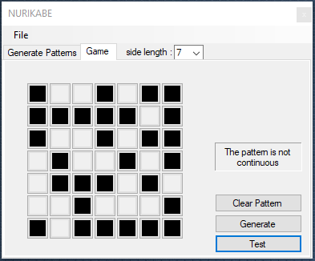
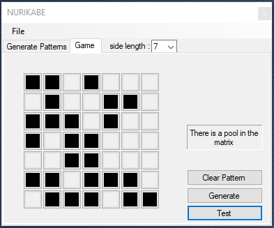
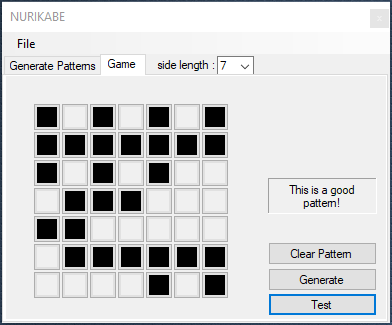

# What is this?

This repository contains the findings of the research that was conducted by students at Missouri Southern State University.

**Students**: [Jonas Smith](https://github.com/JonasESmith), [Jaired Collins](https://github.com/jairedcollins), and [Andrew Robinson](https://github.com/SirArkimedes)

**Advisors**: Dr. Charles Curtis and Dr. Jacob Boswell

# NURIKABE

Applications to test all possible legal patterns for a [n,n] Nurikabe grid.

<h2> Rules </h2>
	<h4> 1. Water (black squares) must be continuous </h4>
		
	<h4> 2. Cannot have pools of water </h4>
		
	<h4> 3. Good pattern </h4>
		

# Solutions

- Brute force
  - A low level approach
  - considers all possible solutions when testing pattern
- Pruning
  - Attempts to prune bad patterns early
  - With large [n x n] prunes nearly 99% of patterns

## Solution Results

    ( Updated 10/10/2026 ) - Corrected 7x7 and 5x5 classes, added nur-rust

|  N  | Good patterns  | Equiv Classes | Prune (s) | Brute (s) | rust-port (s) | nur-rust |
| :-: | :------------- | :------------ | :-------- | :-------- | :------------ | :------- |
| 2x2 | 13             | 4             | ~         | ~         | ~             | < 1 ms   |
| 3x3 | 140            | 31            | ~         | ~         | ~             | < 1 ms   |
| 4x4 | 3,756          | 497           | ~         | ~         | ~             | < 1 ms   |
| 5x5 | 318,890        | 40,572        | 1.209     | 1.157     | 0.062         | < 1 ms   |
| 6x6 | 84,900,755     | 10,615,496    | 67.439    | 2,226.417 | 3.4           | < 1 ms   |
| 7x7 | 70,526,802,085 | 8,816,234,223 | 78,963.73 | N/A       | ~             | 2 ms     |

**Corrections:**
- 7x7 was previously listed as 1,807,325,349. That is the true count modulo 2^32: the C# prune counter is an `int` and wrapped 16 times.
- The 5x5 equivalence-class count was previously listed as 38,858. Both brute-force canonical forms and Burnside's lemma give 40,572.

See [nur-rust](nur-rust/README.md) for the transfer-matrix counter. Results to 17x17, computed on an M4 Max:

| N  | Good patterns | Equiv Classes | nur-rust |
| :-: | :------------ | :------------ | :------- |
| 8  | 181,801,067,635,290 | 22,725,136,631,195 | 8 ms |
| 9  | 1,453,021,880,446,219,833 | 181,627,737,152,352,539 | 26 ms |
| 10 | 35,908,697,917,492,590,578,915 | 4,488,587,239,720,096,790,990 | 47 ms |
| 11 | 2,740,931,314,807,077,983,757,411,602 | 342,616,414,350,997,392,295,409,784 | 0.09 s |
| 12 | 645,356,336,991,577,834,064,108,970,458,897 | 80,669,542,123,947,232,776,841,939,936,682 | 0.22 s |
| 13 | 468336147464432442539277319957690282927 | 58542018433054055376537919032694823565 | 0.6 s |
| 14 | 1046790588647728747480461616766508110955020788 | 130848823580966093435061325154334807875973410 | 1.7 s |
| 15 | 7202366061923427388262225891780715160511014475442802 | 900295757740428423532778536119977485395692530825278 | 7.6 s |
| 16 | 152478931318211468615979883427328339803667992333742346367973 | 19059866414776433576997485428452520044417076361952143677615 | 18 s |
| 17 | 9929063745031935247890777228988377062411999554383111298043882115866 | | 58 s |
| 18 | 1988110212420663583149643542851236792048983465756040531985371494758311961136 | | 190 s |
| 19 | 1223764590313000893662434448911665916137196775511215594353885983484883047025281502957 | | 25 min (modular) |

### Predicting larger n

No closed form is known for any n. The closely related count without the 2×2 rule is an open problem (A. Vince, 2017). The counts follow this asymptotic form:

    ln a(n) ≈ 0.56050·n² − 0.46500·n + 2.0462 − 0.6564·ln n

- **0.56050:** the growth per cell (each cell multiplies the count by about 1.7516). It comes from cylinder transfer-matrix eigenvalues.
- **The remaining constants:** fitted to the exact 17×17 to 19×19 values.

How well it predicts:
- **Held-out sizes:** fitted on n ≤ 14, it predicts 15×15 to 19×19 within 0.002%.
- **Blind test:** 19×19 was predicted to 0.002% before it was computed.
- **Larger n:** predicted a(20) ≈ 2.3152e93, a(25) ≈ 1.1514e147 and a(30) ≈ 8.7211e212. The uncertainty is about 0.01%, 0.1% and 0.3% respectively.

Every fixed width h has an exact formula; for example, width 2 is 6·2^w − 3w − 5. See [nur-rust](nur-rust/README.md) for the derivation, the strip formulas and the validation details.

  

## Solution Results for islands of size one

    ( updated 10/29/19 )  - using rows that only use islands of size 1

- The idea for these results is to use rows to construct the puzzles like this for a 4x4 row `{ 0, 1, 0, 1 }` where island size cannot be greater than one.

| n   | Patterns      | Time in (ms)            | recursive method calls   | possible patterns (2^n^2)  |
| --- | ------------- | ----------------------- | ------------------------ | -------------------------- |
| 2   | 4             | ~                       | 9                        | 16                         |
| 3   | 12            | ~                       | 49                       | 512                        |
| 4   | 46            | ~                       | 368                      | 65,536                     |
| 5   | 302           | ~                       | 4,573                    | 33,554,432                 |
| 6   | 2800          | ~                       | 90,821                   | 68,719,476,736             |
| 7   | 39236         | 169                     | 2,993,954                | 562,949,953,421,312        |
| 8   | 800030        | 6,861                   | 159,103,215              | 18,446,744,073,709,551,616 |
| 9   | 23,892,610    | 535,480                 | 418,244,822              | 2^81                       |
| 10  | 1,036,381,448 | 62,935,121 (17.5 hours) | \*\* (stopped recording) | 2^100                      |
